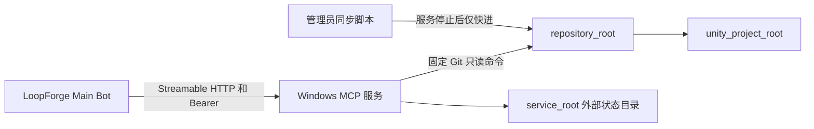

# Unity Project MCP 架构

服务在 Windows 上使用官方 MCP Python SDK，通过 `/mcp` 提供无状态 Streamable HTTP。LoopForge 的执行器作为客户端连接。服务进程只读取 Git 和 Unity 项目数据，管理员同步脚本单独持有写权限。

- `repository_root` 由 Git 验证。`unity_project_root` 是仓库中的 Unity 子目录，业务路径、文件索引和 Git 工具全部使用仓库相对路径。
- `service_root`、服务代码、日志和缓存均在参考仓库之外。Windows 监听进程与同步脚本使用由规范化仓库根目录派生的系统互斥量。实际参考仓库由 `git -C D:\UnityReference\pet_ref\client rev-parse --show-toplevel` 确认为 `D:/UnityReference/pet_ref`，Unity 根目录为 `client`。
- 启动时读取完整 SHA、分支、提交时间和已跟踪文件状态。从该提交的 Git 树建立文件目录索引。内容读取使用提交中的 Git blob，避免查询时的工作树内容漂移和 Git 过滤器执行。查询前后检查基线和工作树状态，发现异常后拒绝继续查询。
- 统一访问策略校验相对路径、显式允许目录、敏感名称和 Windows 重解析点。列表和文件名搜索只查看已授权的提交目录索引。代码搜索使用固定字面量参数，Git 搜索提交中的候选文件，ripgrep 可以在指定文件的已授权 Git 内容中检索。跨文件搜索默认只搜索 C#。
- 被授权的 Git 历史路径共享同一访问策略。资源 GUID 索引延迟构建，按基线与范围保存在外部缓存中。资源和程序集工具基于文本，返回可验证的文件路径、行号和未解析状态。
- HTTP 层在路由前执行鉴权及 Host、Origin 校验。查询在线程池运行，应用并发和端到端时限。Git 与 ripgrep 受固定参数和有界输出约束。Windows Job Object 在超时或超限时终止子进程树。工具日志记录工具名、耗时、数量和错误码。

部署采用标准 MCP SDK 的 ASGI 应用，负责版本协商、JSON-RPC 和工具发现。服务通过自身中间件验证静态 Bearer Token。部署端可以使用保留 Host 校验的 HTTPS 反向代理。SDK 版本依据官方发布和安装包 API 核实。 [MCP Python SDK 2.3.0](https://pypi.org/project/mcp/2.3.0/)
